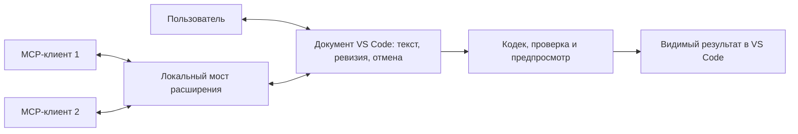

# BGIN 3.7.0, 5.8.0 и совместная работа через MCP

Дата исследования и реализации: 2026-11-14. Подготовлена локальная версия
0.6.0; публичный выпуск не выполнялся. Владелец — отдельный
репозиторий Binary GIN Editor, исходная ревизия `f4a1a3c`. Прежний проект
`bgin-editor` не является текущим редактором.

Уточнение пользователя от 2026-11-14: четыре отдельных режима — **~0.0.2,
~1.6.0, ~3.7.0, ~5.8.0**. Ранее поддерживаемая запись с буквальными именами
получает отдельный режим ~0.0.2. Совместимость сжатия ресурсов проверяется
отдельно от BGIN; старый движок не становится способным читать новое сжатие
после конвертации описания интерфейса. Конвертация текстур выполняется отдельно
по выбору пользователя; сохранение или конвертация BGIN её не запускает.

## Вывод

Исследованные файлы принадлежат одной семье BGIN, но имеют разные способы
двоичной записи. Одной замены заголовка недостаточно. Нужен общий редактор
с отдельными вариантами кодека; обычное сохранение должно сохранять исходный
вариант. Преобразование в другой вариант следует сделать отдельной операцией
с проверкой представимости данных.

MCP связан с живыми документами VS Code. Отдельный режим сохранён явно;
подключённый режим читает текущий текст, включая несохранённые ручные правки.

## Реализовано в 0.6.0

- Четыре явных профиля JSON: `a8-0.0.2`, `a8-1.6.0`, `a8-3.7.0`,
  `a8-5.8.0`. Открытие определяет профиль, сохранение его удерживает;
  конвертер отдельно выбирает другой профиль и отказывает при потере данных.
- Неизвестные имена представлены зарезервированными идентификаторами
  `#1234ABCD`. Дополнительные значения хранятся как `{value, variants}`,
  новые цветовые каналы кадров — как `color_channels`. Данные сохраняются;
  смысл неизвестных ключей не выдумывается.
- Локальный мост обслуживает несколько клиентов. Правки сверяют ревизию,
  входят в штатную отмену; повтор операции не применяет её дважды. Панель
  показывает сессии и действия, позволяет остановить операцию или отключить
  клиента. Галерея показывает его рендеры и отмечает устаревшие результаты.
- Новые PVR с ETC2/ASTC и оболочками `jlz4/jetc`, `zstd/jetc`
  декодируются для предпросмотра. Для Zstd v0.6 требуется сборка библиотеки
  с `ZSTD_LEGACY=1`; обычный готовый пакет Python этого не обеспечивает.
- `bgin_resource_report(..., target_format="a8-1.6.0")` сообщает известные
  несовместимости текстур. Отсутствие замечаний не является проверкой в игре.
- Команда VS Code **BGIN: Convert Texture Separately** и модуль
  `python -m bgin_json.texture_conversion` отдельно снимают оболочку либо
  переводят каждый уровень mip в RGBA8. Нужен отдельный выходной файл;
  прежний файл назначения при явной замене получает резервную копию.
  Альфа-текстура конвертируется отдельно. RGBA8 увеличивает размер ресурса.

Основной GUI 5.8.0 затем предоставлен пользователем из распакованного
установщика кэша стороннего мода, не связанного с Octane. В нём 96 BGIN;
85 проходят побайтную пересборку продуктовым кодеком. 11 файлов содержат
специальные записи второй таблицы и явно отклоняются: `download_minigame`,
`end_race_screens`, `gauntlet_menu`, `inventory`, `loading_menu`, `multiplayer`,
`profile_social_menu`, `prokits_card_templates`, `prokits_menu`, `quick_run_menu`,
`sequences`. Проверка независимой пересборки и редактирования записана в
[bgin-580-main-summary.json](bgin-580-main-summary.json).

### Два источника ресурсов

В окне **Resources** есть выбор между распакованным архивом и распакованной
`zdata / Play Asset Delivery`. Для второго варианта выбирают корень `zdata`,
`files` или `assetpacks`; автозаполнение находит
`common_pack/<версия>/<ревизия>/assets/data/gui`, шрифты `texter_fonts`
и пакеты `textures_pack*`. Числа берутся из структуры выбранной папки,
а не закреплены за профилем BGIN. При нескольких версиях выбор неоднозначен:
нужно выбрать конкретную `assets/data` либо задать папки вручную.

Полная копия игры не требуется. Достаточно нужных BGIN (обычно также
`widgets.bgin` и `sprites.bgin`), используемых пакетов текстур и нужных шрифтов.
Можно отдельно указать любую из этих папок и оставить остальные пустыми.
Текстуры читаются из ZIP-варианта JPK по запросу; распаковка всего пакета
не выполняется. Два совпадающих имени в разных пакетах дают явную ошибку,
чтобы не смешивать версии и GPU-варианты. Исходные JPK не меняются.

### Подключение MCP

Локальный мост входит в VSIX. Адаптер `stdio` запускается отдельно из Python
с установленными зависимостями `mcp`; системный Python нужен адаптеру,
но не обычному редактору. В левой панели нажмите **Copy client command**,
передайте команду клиенту MCP и задайте каждому клиенту своё имя:

```text
bgin-mcp --mode connected --editor-bridge <файл-подключения> --client-name <имя>
```

Файл подключения принадлежит одному окну VS Code. Сервер читает настройки
ресурсов этого проекта. Клиент подписывается на `bgin://editor/state`;
каждая правка содержит `base_revision` и `operation_id`. Уведомления о ручных
правках отправляются немедленно после обнаружения, но момент включения события
в контекст уже работающей модели определяется самим MCP-клиентом.

## Полученные входные данные

Номера 3.7.0 и 5.8.0 заданы пользователем. Изменённые имена версий в манифестах
сохранены в перечне происхождения; сами по себе они не устанавливают розничную
версию игры.

| Источник на телефоне | Получено и проверено |
| --- | --- |
| `Android/data/com.gameloft.android.ANMP.GloftA8PM/files/gui` | 74 BGIN, включая `widgets.bgin`, `sprites.bgin`, `sequences.bgin`; пакет сообщает `versionCode=37060`. |
| `Android/data/com.gameloft.android.ANMP.GloftA8HM580` | В указанной папке нет BGIN; найдено 18 архивов JPK с дополнительными трассами. Пакет сообщает `versionCode=58011`. |
| Установленный APK `com.gameloft.android.ANMP.GloftA8HM580` | Извлечено 13 BGIN из `assets/releaseminigame`, включая `widgets.bgin` и `sprites.bgin`. Это интерфейсы встроенной мини-игры, не полный основной интерфейс. |

В перечисленных папках `Android/data` нет архивов OBB или ZIP. У PM имеются
распакованные интерфейсы и 68 JPK во всём дереве. У HM580 основной набор
интерфейсов в указанном месте не найден. Отдельная копия данных с именем HM
в другом месте телефона не включалась в исследуемый корпус: её принадлежность
5.8.0 не установлена.

Большие входы и исследовательские программы находятся во внешней рабочей папке,
задаваемой как `BGIN_RESEARCH_ROOT`. В ней `receipt.json` содержит пути
происхождения, размеры и SHA-256 каждого BGIN, сведения пакетов и SHA-256 APK.
Контрольные суммы APK и трёх основных файлов PM сверены между телефоном и ПК.
Копирование и исследование не изменяли файлы телефона.

## Где находится основной пакет 5.8.0

Интернет-источники и сам APK указывают на Play Asset Delivery, пакет
`common_pack`. В `classes.dex` проверены строки `common_pack`,
`AssetPackManagerFactory`, `5.8.0k` и `58011`; в манифесте — служба
`com.google.android.play.core.assetpacks.AssetPackExtractionService`.
Это более точное основание, чем предположение о скрытом OBB.

По [официальной документации Android](https://developer.android.com/guide/playcore/asset-delivery/integrate-java#check-status),
пакеты доставки после установки находятся во внутреннем хранилище приложения.
Действительное расположение получают через `getPackLocation()` и `assetsPath()`;
путь может меняться после обновления. Доставка при установке также может
использовать `AssetManager`.

[Сообщение 4PDA от 02.01.2022](https://4pda.to/forum/index.php?showtopic=492661&view=findpost&p=112110852)
приводит для более поздней версии путь
`/data/data/…/files/assetpacks/common_pack/61008/61008/assets/data`.
[Продолжение обсуждения](https://4pda.to/forum/index.php?showtopic=492661&view=findpost&p=112115021)
отмечает, что схема уже использовалась несколько месяцев.
[Обсуждение каналов распространения](https://4pda.to/forum/index.php?showtopic=492661&view=findpost&p=112132262)
различает расположение данных Google Play и Amazon: нельзя считать один путь
обязательным для всех сборок игры.

Для установленного пакета Android подтверждает внутренний каталог
`/data/user/0/com.gameloft.android.ANMP.GloftA8HM580`. Ожидаемый относительный
путь от него — `files/assetpacks/common_pack/<версия>/<версия>/assets/data`.
Наличие и номера подкаталогов на этом телефоне **не проверены**: доступ shell
запрещён, root отсутствует, а `run-as` сообщает, что пакет не отладочный.
Распакованный установщик пользователя подтвердил `58011/58011` для этой копии.
Наличие именно этого пути в закрытом хранилище телефона не проверено. Отсутствие
основного пакета в доступном `Android/data` не означает его отсутствия на телефоне.

## Подтверждённые различия двоичной записи

Сравнение с поддерживаемым вариантом 1.6.0 основано на текущих кодеках
[_wire.py](../../src/bgin_json/_wire.py),
[writer.py](../../src/bgin_json/writer.py) и
[независимом кодеке](../../vendor/bgin_core/reader.py).
Назначение новых полей в движке из одной структуры байтов не выводится.

| Часть файла | Поддерживаемый вариант 1.6.0 | Исследуемый 3.7.0 | Исследуемый 5.8.0 |
| --- | --- | --- | --- |
| Начальные сигнатуры | `0x000C1AAA`, `0x9456A530` | Те же | Те же |
| Каталог | Одна таблица пар хеш/смещение и повтор числа записей | Размер блока, две таблицы и дополнительный счётчик | Такой же общий вид расширенного каталога |
| Обычный узел | Хеш типа, размер, имя, 20 байт преобразования | В разобранных обычных узлах тот же вид | В разобранных обычных узлах нет прежнего блока из 20 байт |
| Число значений свойства | `u16` | В разобранных свойствах `u16` | `u8` |
| Дополнительные наборы значений свойства | Нет соответствующего блока в текущем кодеке | Не обнаружены в разобранных обычных свойствах | После основных значений имеются дополнительные записи с хешем и значениями |
| Кадры анимации | Существующий набор записей | Обычные поддерживаемые записи проверяются отдельно от второй таблицы | Для флага `0x20` обнаружена новая запись хеш/интерполяция/число компонент/`f32[]` |

Расширенный каталог содержит `u32` размера, `u16` числа записей первой таблицы,
её пары `u32` хеш/смещение, затем `u16` числа записей второй таблицы и её пары.
Наблюдаемая формула размера — `4 + 8 * (n1 + n2)`. После блока расположен
ещё один `u16`. Вторая таблица может быть непустой; её содержимое нельзя считать
обычными узлами только из-за наличия хеша и смещения.

Например, у 3.7.0 `debug_menu.bgin`: конец имени пространства — смещение 20,
размер каталога — 28, первая таблица содержит 3 записи, вторая — 0,
последующий счётчик — 3, первый узел начинается со смещения 54.
У `sequences.bgin` первая таблица пуста, вторая содержит 41 запись;
записи начинаются с другого вида данных, без обычного заголовка узла.
У `prokits_menu.bgin` во второй таблице имеется одна такая запись.

У 5.8.0 `download_minigame.bgin` содержит 5 записей первой таблицы и 1 второй,
`end_race_screens.bgin` — 164 и 10, `sequences.bgin` — 0 и 63.
Исследовательское чтение обычных узлов этих специальных записей не покрывает.

У 5.8.0 после значений свойства расположен `u8` числа дополнительных записей.
Наблюдаемый вид дополнительной записи: `u32` хеша, `u8` числа значений,
затем значения. В `HorizontalSpring.StretchFactor` обнаружено ненулевое число
таких записей. Нельзя записывать этот байт как постоянный ноль или объявлять
блок неиспользуемым. Смысл хеша и условия выбора значений пока не подтверждены.

Отдельный случай 3.7.0 — обновлённый `car_poster_images.bgin`: каталог содержит
1430 разных смещений, каждое на 16 байт раньше соответствующего фактического
узла. Последовательное чтение даёт 1430 полных узлов до конца файла, и все
хеши имён совпадают с таблицей; последующий счётчик при этом равен 1428.
Причина несогласованности не установлена. Автоматическое исправление такого
входа нельзя включать в обычное распознавание формата.
У `options_menu.bgin` адреса и хеши 23 фактических узлов согласованы, но
последующий счётчик равен 21; причина также не установлена.

## Первичная проверка исходной ревизии

Следующие результаты относятся к исследованию до реализации 0.6.0.
В текущей версии неизвестные имена сохраняются как идентификаторы `#1234ABCD`;
70 файлов 3.7.0 и 10 файлов мини-игры 5.8.0 проходят независимую
проверку исходных байтов, переименования корня и повторного чтения.
Основной GUI 5.8.0 проверен отдельно: 85 из 96 файлов.


Продуктовые кодеки исходной ревизии `f4a1a3c` отвергали все 74 исходных BGIN 3.7.0 и все 13
образцов 5.8.0 уже при чтении каталога. Исследовательские адаптации выполнялись
во внешней рабочей папке и не меняли исходные файлы или продуктовые кодеки.

Для 3.7.0 после адаптации только заголовка 70 из 74 файлов целиком прочитаны
двумя независимыми двоичными кодеками. Принудительная пересборка независимым
кодеком дала точное совпадение байтов всех 70 адаптированных файлов. Это
проверка адаптированного представления, а не готового сохранения в формате 3.7.0.

Существующий чистый JSON смог представить только `widgets.bgin`; ещё 69
двоично читаемых файлов отклонены из-за отсутствия имён в словаре. Обнаружены
5 неизвестных хешей типов и 29 неизвестных хешей свойств. Расширения каталога
недостаточно для открытия всего корпуса в нынешнем редакторе.

Для `car_poster_images.bgin`, `options_menu.bgin` и обычных UI-объектов
`prokits_menu.bgin` отдельно построены исследовательские представления,
прочитанные и побайтно пересобранные независимым кодеком. Они не доказывают
безопасность автоматического исправления первых двух файлов или сохранения
специальной записи `prokits_menu.bgin`. 41 специальная запись `sequences.bgin`
и одна запись `prokits_menu.bgin` остаются неразобранными.

Для 5.8.0 исследовательский кодек полностью прочитал 10 из 13 файлов и заново
собрал их из разобранных полей. Все 10 совпали с оригиналами побайтно;
возврат исходных байтов вместо записи полей не использовался. Независимая
исследовательская адаптация `bgin_core` прочитала те же 10 файлов; узлы,
свойства, дополнительные наборы значений и границы сверены между кодеками.

В этих 10 файлах разобраны 29 231 узел, 317 108 свойств и 1849 кадров анимации.
У 212 свойств есть дополнительный набор значений с одним из двух неизвестных
хешированных ключей. В словаре отсутствуют имена 4 хешей типов и 31 хеша
свойств; это не доказывает появления этих типов именно после 1.6.0.
74 записи второй таблицы оставшихся трёх файлов пока не разобраны. Проверка
пересборки без изменений не заменяет испытаний редактирования и конвертации.

Подробные результаты:
[bgin-370-summary.json](bgin-370-summary.json),
[bgin-580-summary.json](bgin-580-summary.json).
Происхождение и контрольные суммы обоих корпусов:
[bgin-inputs.json](bgin-inputs.json).

## Чтение, сохранение и конвертация

1. Определять вариант по структуре файла с проверкой размеров, границ и всех
   таблиц. Общая сигнатура и название APK для этого недостаточны. При
   неоднозначности сообщать её, не выбирать наиболее похожий вариант молча.
2. Сохранять вариант записи как свойство документа. Он должен переживать
   сохранение, повторное открытие, экспорт в переносимый JSON и восстановление
   редактора. В исходной ревизии поле `format` различало только `hashed` и `legacy`;
   существующего значения по умолчанию для новых вариантов недостаточно.
3. Обычные «Сохранить» и «Сохранить как» сохраняют формат исходника. При создании
   нового документа целевой вариант выбирается явно. Поддержку формата
   показывать отдельно от покрытия предварительного просмотра.
4. Отдельная команда «Преобразовать в…» выбирает целевой вариант и проверяет
   каждую используемую возможность. Отсутствующий в цели блок, неизвестный
   тип, дополнительный набор значений или неподдерживаемая анимация должны
   давать адресованное сообщение о невозможности преобразования без потерь.
   Не удалять их ради успешной сборки.
5. Для сохранения в исходном варианте сохранять неизвестные данные и их
   принадлежность. Непонятный блок с возможными внутренними смещениями нельзя
   просто перенести вслед за выросшим соседним узлом. Пока безопасность
   переписывания не подтверждена, соответствующие изменения должны отклоняться,
   а исходный файл оставаться доступным для восстановления.
6. Не превращать чистый редактируемый JSON в произвольный дамп хешей. При этом
   экспорт, заявленный как полноценный заменитель исходного файла, обязан
   сохранять вариант и все нужные данные. В 0.6.0 модель расширена для
   неизвестных идентификаторов, дополнительных значений и цветовых каналов.
7. Перед записью требуются чтение независимым кодеком, сверка структуры и
   проверка сохранности. Пересборка без изменений и правка реального свойства —
   разные проверки. Успешное двоичное преобразование не подтверждает поведение
   интерфейса в игре.

Таким образом, общий редактор, сохранение исходного варианта и явный конвертер
нужны совместно. Степень похожести файлов не отменяет выбора целевого формата.

## Совместная работа редактора и MCP

Распределение ответственности в 0.6.0:

- [BginDocument](../../vscode/src/document.ts) хранит текст и ревизию, рассылает
  изменения вкладкам. [Provider](../../vscode/src/extension.ts) владеет открытыми
  документами и регистрирует изменения в истории отмены VS Code.
- [Левая панель](../../vscode/src/converterView.ts) до изменений обслуживала только конвертер.
- [MCP](../../src/bgin_json/mcp_server/server.py) работает через `stdio`;
  [Service](../../src/bgin_json/mcp_server/service.py) сохраняет отдельный режим
  работы с файлами. Подключённый адаптер использует общий документ редактора.
- [Предпросмотр](../../vscode/src/preview.ts) уже проверяет ревизию перед показом
  результата. Правки webview содержат базовую ревизию; конфликт сохраняет
  ручной черновик и не заменяет более свежий общий документ.

Схема реализованного подключения:



Один локальный мост принадлежит конкретному окну VS Code и обслуживает
несколько независимых сессий. Существующий вход `stdio` можно сохранить
в виде адаптера каждого клиента к общему мосту. Документ определяется
устойчивым идентификатором; путь нужен для открытия, но не заменяет
идентичность документа и окна. Подключённый режим не должен незаметно переходить
к работе с отдельной дисковой копией, когда редактор недоступен.

Каждый клиент видит актуальный общий документ, включая несохранённые правки.
Правка содержит базовую ревизию и идентификатор операции. После проверки
кодеком ревизия проверяется снова; весь пакет применяется одним действием
штатной истории отмены. Если человек или другой клиент изменил документ,
подготовленный пакет получает конфликт и актуальные изменения. Это правило
распространяется и на сообщения webview. Повтор запроса после обрыва соединения
не должен повторять уже применённую операцию.

Временно неверный JSON остаётся видимым общим текстом с диагностикой.
Структурные правки и сборка не должны продолжаться по скрытой старой копии.
Сохранение фиксирует конкретную ревизию и не должно объявлять более новые
правки сохранёнными. Изменение файла извне требует отдельной проверки конфликта.

Левая панель Binary GIN объединяет конвертер и подключения MCP. В ней видны
клиенты, их текущие документы, действия и ошибки.
Пользователь может открыть затронутый документ, приостановить правки клиента,
остановить ещё не применённую операцию или отключить сессию. Уже применённое
изменение отменяется обычной командой VS Code.

Рендер запускается по снимку с ревизией документа и ресурсов и виден в редакторе
с указанием автора. Устаревший результат помечается или отбрасывается.
Подготовка изображения не блокирует ручное редактирование; несколько вариантов
показываются в галерее без принудительного переключения текущего экрана.
Настройки ресурсов общие с открытым проектом.

MCP рассылает уведомления об изменениях и предоставляет получение накопленных
изменений после заданной ревизии. Любой следующий вызов получает актуальное
состояние. Возможность немедленно передать событие в контекст уже работающей
модели зависит от клиента MCP; одних серверных уведомлений для такого обещания
недостаточно. Нужны и уведомления, и обязательная проверка ревизии при обращении.

Минимальный проверяемый сценарий: человек и два клиента открывают один документ;
первый клиент меняет свойство, человек видит и отменяет либо исправляет правку;
второй клиент получает конфликт при попытке применить старую ревизию,
перечитывает ручную правку и строит новый предпросмотр. Результат виден в VS Code;
после сохранения файл независимо проверяется и повторно открывается.

## Границы результата

Реализованы кодеки поддерживаемых записей, сохранение с независимой проверкой,
явная конвертация, мост MCP и два сценария ресурсов. Специальные записи второй
таблицы, два несогласованных каталога 3.7.0 и кубические PVR явно не поддержаны.
Предпросмотр новых BGIN использует прежнюю модель компоновки, основные значения
свойств; выбор вариантов и новые цветовые каналы не воспроизводятся.

На компьютере проверены двоичная пересборка, правки, отмена и конфликты клиентов,
декодирование текстур и отдельная конвертация. Файлы из телефона скопированы
и сверены, но испытания изменённых ресурсов в игре не выполнялись. Ни формат
сохранения, ни успешный предпросмотр не подтверждают поведение нового движка.
